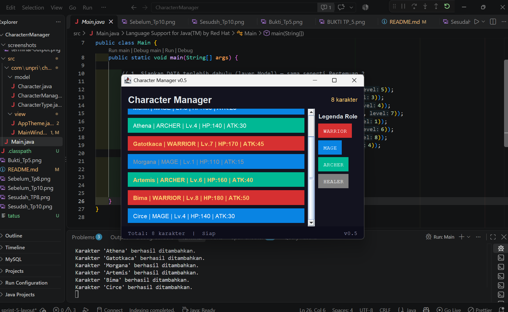
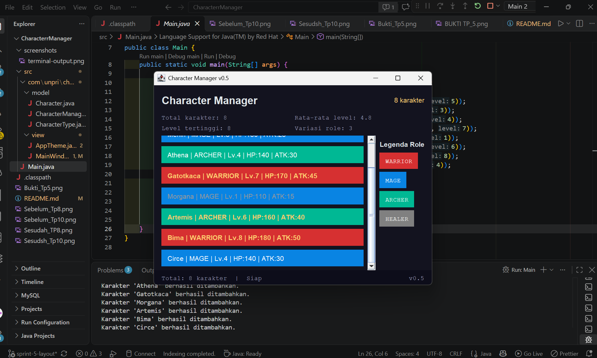
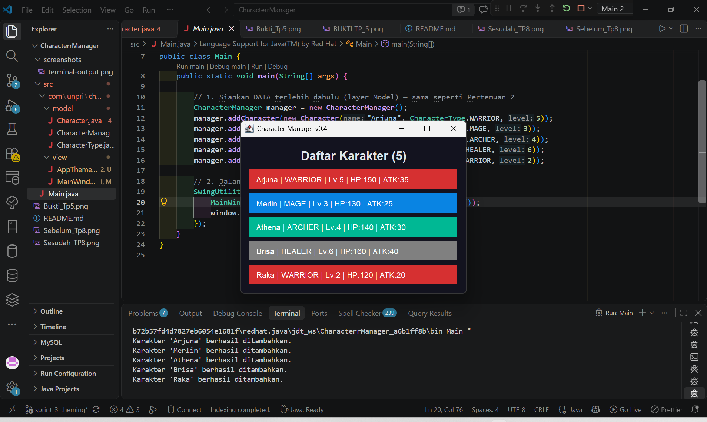
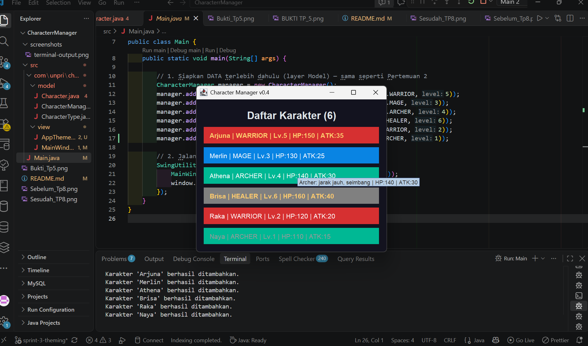
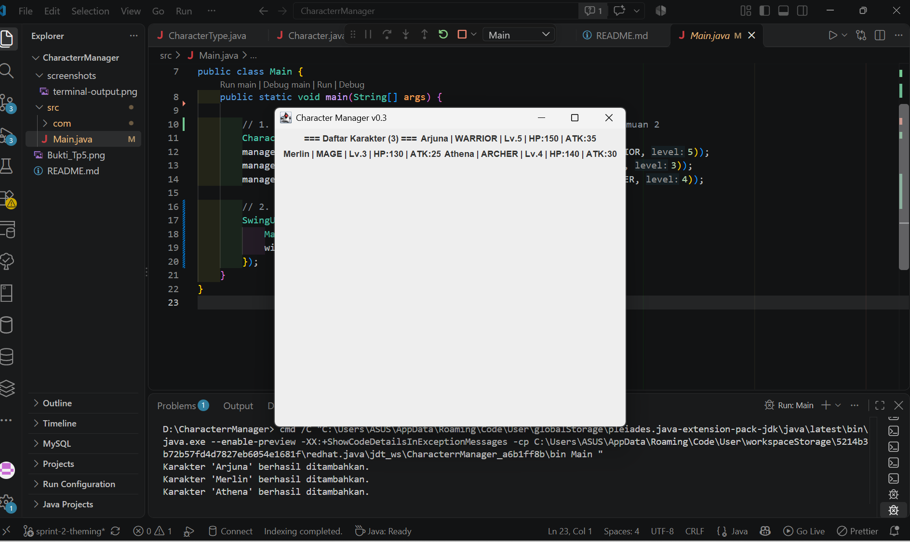
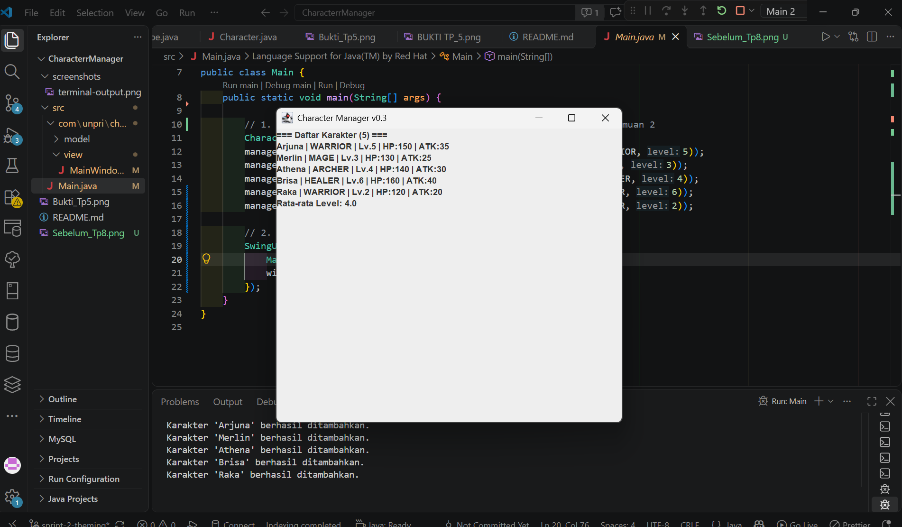
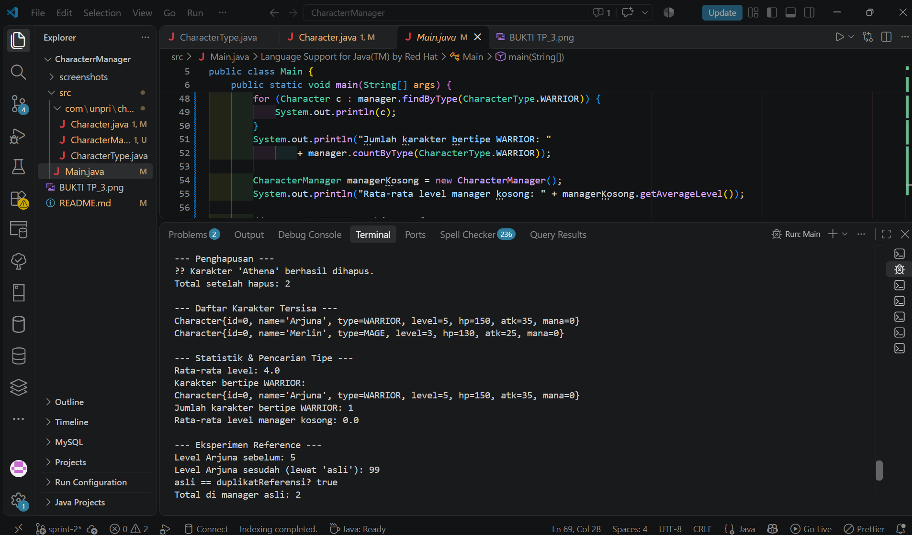

# Character Manager — TP3, TP5, TP8, TP10 & TP12 (Java Visual SIH-6406)

Project Java sederhana untuk mengelola karakter menggunakan class dan enum dalam package modular. Program mendemonstrasikan encapsulation, perhitungan statistik berdasarkan level, serta fitur mana dan status hidup karakter.

## Wireframe MainWindow v0.5

```text
+------------------------------------------------------------------+
| JPanel header — BorderLayout.NORTH                               |
|   JLabel judul                                                   |
|   JPanel statistik — GridLayout(2, 2)                             |
+-----------------------------------------------+------------------+
| JScrollPane — BorderLayout.CENTER             | JPanel legenda   |
|   JPanel kartu karakter                       | BorderLayout.EAST|
|   GridLayout(0, 1)                             | BoxLayout Y_AXIS|
|                                               |                  |
+-----------------------------------------------+------------------+
| JPanel status — BorderLayout.SOUTH                               |
|   BorderLayout: status kiri, versi kanan                         |
+------------------------------------------------------------------+
```

Panel utama menggunakan `BorderLayout`: header berada di utara, daftar kartu yang dapat digulir di tengah, legenda role di timur, dan status di selatan. Daftar karakter memakai `GridLayout(0, 1)` agar kartu tersusun satu kolom; legenda memakai `BoxLayout` pada sumbu Y agar chip role tersusun vertikal. Bar status memakai `BorderLayout`, dengan informasi status di kiri dan versi di kanan. Saat jendela dilebarkan, kedua label tetap menempel di sisi masing-masing dan ruang tambahan berada di antara keduanya; konstanta versi yang sama juga dipakai pada judul jendela.

## TP12 — Praktik Layout dan Bar Status

### Wireframe

Diagram wireframe di atas menunjukkan header dengan ringkasan statistik, daftar kartu yang dapat digulir, legenda role, dan bar status. Struktur panel bersarang terdiri atas `headerArea` yang menampung baris judul dan panel statistik; panel statistik membagi empat metrik dalam `GridLayout(2, 2)`. Area daftar membungkus panel kartu di dalam `holder` lalu `JScrollPane`, sedangkan legenda memakai `BoxLayout` vertikal. Panel luar menggunakan `BorderLayout` agar header, daftar, legenda, dan status menempati wilayah yang terpisah.

### Screenshot dan pengamatan resize

Screenshot TP12 yang tersedia menunjukkan tampilan sebelum dan sesudah panel statistik ditambahkan. Keduanya menampilkan jendela v0.5 dengan delapan karakter; scrollbar daftar juga tampak. Bukti khusus jendela dilebarkan dan jendela yang dikecilkan belum tersedia karena percobaan menjalankan ulang aplikasi melalui debugger tetap timeout.





Screenshot jendela dilebarkan dan jendela dikecilkan hingga scrollbar tampak: **belum tersedia**.

| Ukuran jendela                     | Prediksi                                                                                        | Hasil pengamatan                                                                                                 |
| ---------------------------------- | ----------------------------------------------------------------------------------------------- | ---------------------------------------------------------------------------------------------------------------- |
| Ukuran awal (`pack()`)             | Status di kiri, `v0.5` di kanan; daftar delapan kartu dapat digulir.                            | Terlihat pada screenshot setelah panel statistik: versi di kanan, status di kiri, dan scrollbar ada.             |
| Dilebarkan                         | Kedua label bar status tetap di ujung kiri dan kanan; ruang tambahan berada di antara keduanya. | Belum diamati; screenshot ukuran lebar belum tersedia.                                                           |
| Dikecilkan hingga scrollbar tampak | Scrollbar vertikal terlihat pada daftar; legenda dan bar status tetap di wilayah masing-masing. | Scrollbar tampak pada screenshot yang ada, tetapi perilaku khusus setelah jendela dikecilkan belum diverifikasi. |

Praktik TP12 menyempurnakan `MainWindow` v0.5 dengan menampilkan pesan status di sisi kiri bar bawah dan label versi di sisi kanan. Keduanya ditempatkan menggunakan `BorderLayout`, sehingga ketika jendela dilebarkan, label tetap berada di ujung masing-masing dan ruang tambahan mengisi bagian tengah. Nilai versi diambil dari satu konstanta `APP_VERSION` yang digunakan bersama oleh judul jendela dan label versi agar keduanya tidak berbeda. Bar status memakai `FONT_MONO` dan `TEXT_MUTED` agar tampil konsisten dengan tema aplikasi.

Panel statistik baru ditempatkan di bawah baris judul dan menggunakan `GridLayout(2, 2)` untuk menampilkan total karakter, rata-rata level, level tertinggi, dan jumlah variasi role dalam empat sel seragam. `GridLayout` dipilih karena setiap metrik mendapat ruang konsisten sehingga mudah dipindai. `FlowLayout` ditolak untuk panel ini karena ukuran dan pembungkusan komponennya mengikuti teks, sehingga ringkasan tidak tersusun sebagai kisi yang tetap. Daftar pengujian di `Main.java` memuat delapan karakter dengan variasi role dan level agar scrollbar serta statistik dapat diamati.

### Google Docs Bagian D

Analisis Bagian D TP12 tersedia di [JavaVisual_TP12_253303621206_HERDIANTA_YUVENTUS_TARIGAN](https://docs.google.com/document/d/1c1lU_HgMNg5ltiCjf79oesZlc1haKTKzjiyo-piKiaM/edit?tab=t.0).

## TP10 — Tema dan Kartu Karakter

### Screenshot sebelum dan sesudah





### Pemisahan Tema

Warna disimpan di `AppTheme` agar seluruh tampilan memakai palet yang konsisten dan perubahan tema dapat dilakukan di satu tempat. `Character` adalah bagian Model yang menyimpan data serta aturan karakter, bukan detail presentasi seperti warna layar. Pemisahan ini menjaga Model tetap dapat digunakan tanpa Swing dan mencegah logika tampilan tersebar ke dalam data domain.

### Properti tambahan

- **Tooltip berisi deskripsi role, HP, dan ATK:** memberi detail tambahan saat pengguna mengarahkan kursor tanpa membuat kartu utama lebih padat.
- **Kartu level 1 dinonaktifkan:** menandai karakter pemula yang belum aktif dan membedakannya secara visual dari karakter siap pakai.

### Analisis Bagian D

Dokumen [JavaVisual_TP10_253303621206_HERDIANTA_YUVENTUS_TARIGAN](https://docs.google.com/document/d/1tpQgNeF5r8ub3siiprB1SKBX33Y6sMeUKBOOsReEV6U/edit?tab=t.0) memuat analisis lebih dari 500 kata tentang pola JavaBeans, JLabel opaque, ukuran dan layout Swing, pemisahan warna menurut MVC, serta logical font dan `deriveFont()`.

## TP8 — GUI dan Aliran Data

### Sebelum Perubahan

Berikut tampilan sebelum daftar karakter dinamis dan statistik rata-rata ditambahkan:



### Sesudah Perubahan

Screenshot berikut menunjukkan MainWindow dengan lima karakter awal sebelum Naya ditambahkan:



### Aliran Data dan MVC

`Main` menyiapkan data karakter melalui `CharacterManager`, yang bertindak sebagai bagian Model untuk mengelola koleksi. `Main` lalu mengambil salinan koleksi dengan `getAllCharacters()` dan meneruskannya ke constructor `MainWindow`. `MainWindow` berperan sebagai View: ia mengiterasi data tersebut untuk menampilkan lima karakter dan menghitung rata-rata level. Dengan demikian, pengelolaan data berada di Model, sedangkan penyajian antarmuka berada di View dan `Main` mengoordinasikan keduanya.

### Karakter Tambahan

- **Brisa — HEALER, level 6:** dipilih sebagai karakter pendukung dengan level lebih tinggi agar variasi tipe dan statistik di daftar lebih terlihat.
- **Raka — WARRIOR, level 2:** dipilih sebagai petarung pemula; levelnya yang rendah memberi kontras dengan karakter level tinggi seperti Brisa.
- **Naya — ARCHER, level 1:** dipilih sebagai pemanah pemula, sekaligus memperlihatkan perlakuan khusus untuk karakter level 1.

### Mini-Challenge dan Properti Tambahan

Karakter dengan level minimal `AppTheme.HIGH_LEVEL_THRESHOLD` (5) ditampilkan dengan teks emas dan tebal; batasnya disimpan sebagai konstanta bernama agar mudah disesuaikan. Kartu juga memiliki dua properti tambahan: tooltip menampilkan deskripsi role beserta HP/ATK agar detail dapat dibaca tanpa memenuhi tampilan utama, dan kartu level 1 dinonaktifkan secara visual untuk menandai karakter pemula yang belum aktif.

### Google Docs Bagian D — TP08

Analisis GUI dan MVC tersedia di [JavaVisual_TP08_253303621206_HERDIANTA_YUVENTUS_TARIGAN](https://docs.google.com/document/d/1lyS4s3MnoMAN-d1N3u7ndP_sj4a1jUguXlR-1vEaxYA/edit?tab=t.0). Dokumen dibagikan dengan akses **Anyone with the link — Viewer**.

## TP5 — Fitur dan Bukti

TP5 menambahkan pengelolaan koleksi karakter dan analitik:

- `Character.equals()` membandingkan nama secara case-sensitive; `hashCode()` mengikuti atribut nama.
- `CharacterManager` menyediakan tambah, cari, hapus, hitung total, dan `getAllCharacters()` yang mengembalikan defensive copy.
- `Main` menguji penolakan nama duplikat, CRUD dasar, rata-rata level (termasuk manager kosong), pencarian berdasarkan tipe, dan eksperimen reference/list salinan.
- `getAverageLevel()` menghindari pembagian nol dan mengembalikan `0` saat koleksi kosong.
- `findByType(CharacterType type)` mengembalikan list baru berisi karakter bertipe yang diminta.

### Bukti Output CRUD dan Eksperimen Reference

Screenshot berikut menunjukkan output program, termasuk penghapusan, statistik, dan eksperimen reference:



### Fitur Analitik Bagian C

`CharacterManager.countByType(CharacterType type)` menghitung jumlah karakter untuk tipe yang diminta dan hanya mengembalikan `int`, bukan `ArrayList` internal. Ini menjaga encapsulation: pemanggil dapat membaca ringkasan tanpa memperoleh akses untuk mengubah koleksi manager. Method memiliki Javadoc, dan `Main` mencetak jumlah karakter `WARRIOR`.

### Analisis Bagian D

Analisis reference, primitive value, `static`, `equals()`, dan defensive copy tersedia di [Google Docs TP05 — JavaVisual_TP05_253303621206_HERDIANTA_YUVENTUS_TARIGAN](https://docs.google.com/document/d/1PoDj3Y5tiwgDwD7GP85kalqRDI7SEs2B9YtGIYjkgQs/edit?tab=t.0).

## Bukti Output TP3

Screenshot berikut menunjukkan output program TP3 di terminal, termasuk hasil pemeriksaan `isAlive()`:


---

## **Google Docs Bagian D**

[JavaVisual_TP03_253303621206_HERDIANTA_YUVENTUS_TARIGAN](https://docs.google.com/document/d/1WNTNGIs7jUcQlxoX1jjfeCoGrAsvgfibWJWT-i9Np_I/edit?usp=sharing)

## Struktur Project

```text
CharacterrManager/
├── screenshots/
│   └── terminal-output.png
├── Bukti_Tp12.png
├── Bukti_Tp5.png
├── Sesudah_TP8.png
├── Sesudah_Tp12.png
├── Sebelum_Tp10.png
├── Sesudsh_Tp10.png
├── src/
│   ├── Main.java
│   └── com/
│       └── unpri/
│           └── charactermanager/
│               ├── model/
│               │   ├── Character.java
│               │   ├── CharacterManager.java
│               │   └── CharacterType.java
│               └── view/
│                   ├── AppTheme.java
│                   └── MainWindow.java
└── README.md
```

## Identitas

- **Nama:** HERDIANTA YUVENTUS TARIGAN
- **NIM:** 253303621206
- ---

## **Google Docs Bagian D**
- **Google Docs Bagian D TP3:**[JavaVisual_TP03_253303621206_HERDIANTA_YUVENTUS_TARIGAN](https://docs.google.com/document/d/1WNTNGIs7jUcQlxoX1jjfeCoGrAsvgfibWJWT-i9Np_I/edit?usp=sharing)
- **Google Docs Bagian D TP5:** [JavaVisual_TP05_253303621206_HERDIANTA_YUVENTUS_TARIGAN](https://docs.google.com/document/d/1PoDj3Y5tiwgDwD7GP85kalqRDI7SEs2B9YtGIYjkgQs/edit?tab=t.0)
- **Google Docs Bagian D TP8:** [JavaVisual_TP08_253303621206_HERDIANTA_YUVENTUS_TARIGAN](https://docs.google.com/document/d/1lyS4s3MnoMAN-d1N3u7ndP_sj4a1jUguXlR-1vEaxYA/edit?tab=t.0)
- **Google Docs Bagian D TP10:** [JavaVisual_TP10_253303621206_HERDIANTA_YUVENTUS_TARIGAN](https://docs.google.com/document/d/1tpQgNeF5r8ub3siiprB1SKBX33Y6sMeUKBOOsReEV6U/edit?tab=t.0)
- **Google Docs Bagian D TP12:** [JavaVisual_TP12_253303621206_HERDIANTA_YUVENTUS_TARIGAN](https://docs.google.com/document/d/1c1lU_HgMNg5ltiCjf79oesZlc1haKTKzjiyo-piKiaM/edit?tab=t.0)
