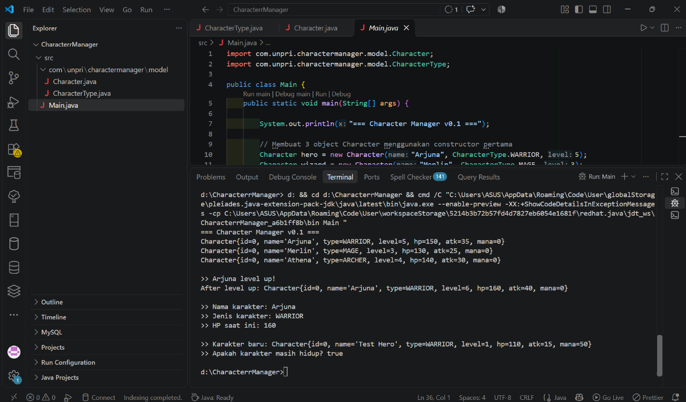

# Character Manager — TP3 (Java Visual SIH-6406)

Project Java sederhana untuk mengelola karakter menggunakan class dan enum dalam package modular. Program mendemonstrasikan encapsulation, perhitungan statistik berdasarkan level, serta fitur mana dan status hidup karakter.

## Bukti Output Program

Screenshot berikut menunjukkan output program di terminal, termasuk hasil pemeriksaan `isAlive()`:



## Struktur Project

```text
CharacterrManager/
├── screenshots/
│   └── terminal-output.png
├── src/
│   ├── Main.java
│   └── com/
│       └── unpri/
│           └── charactermanager/
│               └── model/
│                   ├── Character.java
│                   └── CharacterType.java
└── README.md
```

## Identitas

- **Nama:** HERDIANTA YUVENTUS TARIGAN
- **NIM:** 253303621206
- **Google Docs Bagian D:** [JavaVisual_TP03_253303621206_HERDIANTA_YUVENTUS_TARIGAN](https://docs.google.com/document/d/1WNTNGIs7jUcQlxoX1jjfeCoGrAsvgfibWJWT-i9Np_I/edit?usp=sharing)
